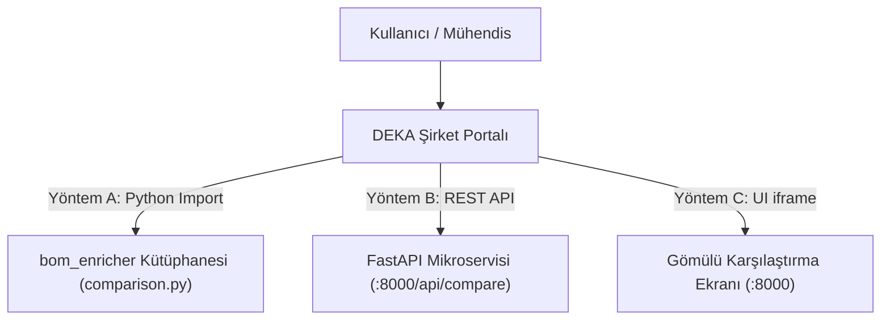

# DEKA BOM Karşılaştırma Modülü — Şirket Portalı Entegrasyon ve Kurulum Kılavuzu

Bu kılavuz, DEKA Şirket Portalı'na (ERP Yönetim Sistemi) entegre edilmek üzere izole edilmiş **Hafif ve Bağımsız BOM Karşılaştırma Motoru** (`portal-bom-comparison` / `feature/portal-bom-comparison`) için hazırlanmıştır.

Modül; ağır PDF/OCR ve yapay zekâ kütüphanelerinden tamamen arındırılmış olup, **%100 deterministik algoritmalar ve kural tabanlı elektriksel semantik motorla** tamamen çevrimdışı (offline) çalışır.

---

## 1. Kendi Bilgisayarında Kurulum (Local Setup)

### Gereksinimler
* **Python:** 3.10 veya üzeri (Windows, Linux, macOS)
* **İnternet / Dış API:** Gerektirmez (tamamen offline çalışır).

### Adım Adım Kurulum
```bash
# 1. Depoyu klonlayın ve portala özel karşılaştırma dalına geçin:
git clone https://github.com/Sudemc/deka-intern.git
cd deka-intern
git checkout portal-bom-comparison

# 2. Sanal ortam (venv) oluşturun ve aktif edin:
# Windows (PowerShell):
python -m venv .venv
.\.venv\Scripts\Activate.ps1

# Linux / macOS:
python3 -m venv .venv
source .venv/bin/activate

# 3. Bağımlılıkları ve paketi yükleyin:
pip install -r requirements.txt
pip install -e .

# 4. Tüm otomatik testleri çalıştırarak doğruluğu teyit edin:
pytest
# (100+ birim ve entegrasyon testinin tamamının 'passed' vermesi gerekmektedir)

# 5. Yerel Web Sunucusunu Başlatın:
# Windows için doğrudan çift tıklayarak:
baslat.bat
# Veya terminalden:
uvicorn bom_enricher.web:app --host 0.0.0.0 --port 8000 --reload
```
Tarayıcınızdan `http://127.0.0.1:8000` adresine girerek kurumsal web arayüzünü doğrudan kullanabilirsiniz.

---

## 2. Şirket Portalı Entegrasyon Yolları

Portal mimarisine ve kullandığınız teknoloji yığınına bağlı olarak 3 farklı entegrasyon yöntemi sunulmaktadır:



---

### Yöntem A: Doğrudan Python Modülü Olarak Çağırma (En Hızlı & Hafif Yol)

Portalınızın backend'i Python (Django, Flask, FastAPI, Celery) tabanlıysa, `src/bom_enricher` klasörünü ve `data/rules.xlsx` dosyasını projenize dahil ederek doğrudan fonksiyon çağrısı yapabilirsiniz:

```python
from pathlib import Path
from bom_enricher import compare_workbooks

# 1. Müşteri BOM Excel Dosyaları (Tek bir dosya veya birden fazla alt kart dosyası listesi)
customer_files = [
    Path("uploads/STOP_TAIL_1.xlsx"),
    Path("uploads/TURN_1.xlsx"),
    # veya tek bir çoklu sekme içeren müşteri workbook'u:
    # Path("uploads/Musteri_Coklu_BOM.xlsx")
]

# 2. ERP Malzeme Listesi Excel Dosyası
erp_file = Path("uploads/ERP_BOM_Giris_Listesi.xlsx")

# 3. Üretilecek Resmi Karşılaştırma Raporu Dosya Yolu
output_path = Path("reports/BOM_Karsilastirma_Raporu.xlsx")

# Karşılaştırma motorunu çalıştırın (Standart BOM <-> ERP Karşılaştırma Modu):
result = compare_workbooks(
    customer_path=customer_files,   # Path veya list[Path]
    erp_path=erp_file,              # Path
    rules_path=None,                # Standart BOM <-> ERP kıyaslaması için None bırakılır
    output_path=output_path,        # Path | None (Verilirse 13 sütunlu renkli Excel üretir)
)

# Sonuçları inceleyin:
print(f"Toplam Satır: {len(result.rows)} | Toplam Parça: {result.total_part_count}")

for row in result.rows:
    durum = row["Durum"]                    # 'HATA', 'UYARI' veya 'UYGUN'
    cust_pn = row["Müşteri Part Number"]    # Müşteri dosyasındaki parça kodu (veya kodları)
    erp_pn = row["ERP Part Number"]         # ERP'deki parça kodu
    cust_qty = row["Müşteri Qty"]           # Müşteri toplam adedi
    erp_qty = row["ERP Qty"]               # ERP adedi
    kaynak = row["Kaynak Kart / BOM"]       # Parçanın hangi karttan/dosyadan geldiği ve adet kırılımı
    aciklama = row["Hata/Uyarı Durumu"]     # Açık hata/uyarı nedeni (UYGUN satırlarda boş string "")
```

---

### Yöntem B: Bağımsız REST API Mikroservisi Olarak Entegrasyon (Docker / C# / Java / Node.js)

Portalınız Python dışında bir dildeyse (ASP.NET, Spring Boot, Node.js, PHP), modülü bağımsız bir HTTP mikroservisi veya Docker container olarak çalıştırabilirsiniz.

#### Docker ile Çalıştırma:
```dockerfile
FROM python:3.11-slim
WORKDIR /app
COPY requirements.txt .
RUN pip install --no-cache-dir -r requirements.txt
COPY src/ ./src/
COPY data/ ./data/
ENV PYTHONPATH=/app/src
EXPOSE 8000
CMD ["uvicorn", "bom_enricher.web:app", "--host", "0.0.0.0", "--port", "8000"]
```

#### API Endpoint: `POST /api/compare`
* **İstek Formatı:** `multipart/form-data`
* **Form Parametreleri:**
  * `customer_files`: 1 veya daha fazla müşteri `.xlsx` veya `.csv` dosyası (Tek dosya için `customer_file` da kabul edilir).
  * `erp_file`: ERP `.xlsx` veya `.csv` dosyası (Zorunlu).
  * `rules_file`: `rules.xlsx` kural sözlüğü (Opsiyonel).

#### Dönen JSON Yanıtı Örneği:
```json
{
  "result_id": "9a4f21bc...",
  "row_count": 43,
  "total_part_count": 38,
  "clean_count": 34,
  "warning_count": 5,
  "error_count": 4,
  "info_count": 5,
  "issue_count": 9,
  "download_url": "/api/results/9a4f21bc.../workbook",
  "rows": [
    {
      "Durum": "HATA",
      "Müşteri Part Number": "LA G6SP.02",
      "ERP Part Number": "LA G6SP.02",
      "Müşteri Qty": "12",
      "ERP Qty": "24",
      "Müşteri Value": "SMD PLCC-6, Amber, Bin:8E-5F",
      "ERP Description": "SMD PLCC-6, Amber, Bin:8E-5F",
      "Müşteri TH/SMD": "SMD",
      "ERP TH/SMD": "SMD",
      "Kaynak Kart / BOM": "STOP TAIL 1 (ST1), STOP TAIL 2 (ST2)",
      "Müşteri Referans": "ST1L_LED1..4, ST1R_LED1..4, ST2L_LED1..2, ST2R_LED1..2",
      "ERP Referans": "ST1L_LED1..4, ST1R_LED1..4, T1L_LED1..5, T1R_LED1..5, ST2L_LED1..2, ST2R_LED1..2, T2L_LED1, T2R_LED2",
      "Hata/Uyarı Durumu": "Miktar Uyuşmazlığı (Müşteri: 12, ERP: 24); Dizgi/Referans farkı (Fark: ERP'de Farklı/Fazla: T1L_LED1..5, T1R_LED1..5, T2L_LED1, T2R_LED2)"
    }
  ]
}
```

* **Rapor İndirme Endpoint'i:** `GET /api/results/{result_id}/workbook`  
  Kullanıcının tek tıkla indirebileceği, kurumsal renklendirilmiş (Kırmızı Hata, Sarı Uyarı, Açık Mavi Montaj Dışı, Temiz Uygun) 13 sütunlu `.xlsx` dosyasını döner.

---

### Yöntem C: Portal Arayüzüne Doğrudan Sekme / iframe Olarak Gömme

Portala yeni bir backend kodu yazmak istemiyorsanız, modülün hazır kurumsal arayüzünü portal içine iframe olarak gömebilirsiniz:

```html
<iframe 
    src="http://<sunucu-ip>:8000" 
    style="width: 100%; height: 900px; border: none; border-radius: 8px;">
</iframe>
```

---

## 3. Yazılım Mühendislerinin Bilmesi Gereken Çekirdek Domain Mantığı

BOM karşılaştırma motoru basit bir metin eşleştiricisi **değildir**. Otomotiv elektroniği, savunma/havacılık kartları ve DEKA üretim kurallarına göre özelleştirilmiş aşağıdaki akıllı mekanizmaları içerir:

### 1. Otomotiv Simetrisi ve L/R (Sol / Sağ) Çiftleme Algoritması
* Otomotiv müşteri listelerinde sağ ve sol lambalar için aynı devre şeması simetrik olarak tasarlanır (Örn: `ST1L_` ve `ST1R_`).
* Müşteri BOM satırında `Designator: R1, R2` ve `Quantity: 2` yazarken, referanslar `ST1L_R1, ST1L_R2, ST1R_R1, ST1R_R2` şeklinde 4 adet verilmişse sistem:
  * Bunu mükerrer yazım hatası olarak görmez.
  * Sol ve Sağ simetri çiftlerini (`L` ve `R`) otomatik algılar, toplam adedi $2 \times 2 = 4$ olarak hesaplar ve ERP'deki 4 adet ile **UYGUN** olarak eşleştirir.

### 2. Uydu Kart (Satellite Board) Önek Genişletme
* Tek bir PCB üzerinde hem sol hem sağ kanal yer alan uydu kartlarda (`ST2` veya `T2`), ERP tarafında `ST2L` ve `ST2R` önekleri kullanıldığında sistem bu ilişkiyi otomatik çözer; sahte kart öneki hatası üretmez.

### 3. Aktif Montaj (SMD) ve Dizilmez (DNP / Process: NM) Otomatik Ayrımı
* Müşteri listesinde aynı parça hem aktif montaj (Örn: 30 adet SMD) hem de dizilmeyecek opsiyonel montaj (Örn: 16 adet `Process: NM`) olarak ayrı satırlarda tanımlanmış olabilir.
* ERP operatörü bu iki kalemi toplayıp tek satırda 46 adet girmiş olsa bile motor:
  * ERP'deki 46 referansı müşteri referans kümeleriyle (`crefs` ve `nm_refs`) karşılaştırır.
  * 30 adet aktif kısmı `UYGUN` olarak işaretler.
  * 16 adet NM kısmı `UYARI` ("Montaj Dışı (Process: NM) - Dizilmemelidir") olarak işaretler.
  * Sahte miktar uyuşmazlığı (`30 != 46` gibi) üretilmesini engeller.

### 4. Alternatif Parça, LED BIN Kodu ve Çoklu Üretici Kodu Çözümleme
* ERP malzeme koduna eklenen `BIN: 8E-5F`, `BIN TABLE1` gibi lot/bin bilgileri otomatik temizlenir.
* `4E12000022(AC0603FR-0710KL)` gibi DEKA kodu ile üretici parça numarasının birleşik yazıldığı hücrelerde veya aynı hücrede birden fazla onaylı üretici kodu bulunduğunda tüm alternatif kodlar ayrıştırılarak tam eşleşme sağlanır.

### 5. Açık Referans Farkı (RefDes Diff)
* Dizgi referanslarında bir uyuşmazlık olduğunda sadece genel bir hata mesajı basılmaz; doğrudan hangi referansların ERP'de fazla veya müşteride eksik olduğu açıkça parantez içinde listelenir:  
  `Fark: ERP'de Farklı/Fazla: ST1L_C22, ST1R_C22`

---

## 4. Klasör ve Dosya Referansı

| Dosya Yolu | Sorumluluk Alanı |
| :--- | :--- |
| [`src/bom_enricher/comparison.py`](src/bom_enricher/comparison.py) | Çok aşamalı eşleştirme, simetri uzlaştırma ve 13 sütunlu Excel rapor üreticisi. |
| [`src/bom_enricher/excel_io.py`](src/bom_enricher/excel_io.py) | Müşteri ve ERP Excel/CSV dosyalarını akıllı başlık tespit algoritmasıyla okuyan modül. |
| [`src/bom_enricher/semantic_parser.py`](src/bom_enricher/semantic_parser.py) | Elektriksel birim, kılıf, voltaj, tolerans ve montaj tipi normalizasyonu ($10\mu\text{F}$, $100\text{nF}$, $10\text{k}\Omega$, $1\text{ M}\Omega$). |
| [`src/bom_enricher/models.py`](src/bom_enricher/models.py) | Veri yapıları ve modelleri (`CustomerBomRow`, `ComponentData` vb.). |
| [`src/bom_enricher/web.py`](src/bom_enricher/web.py) | FastAPI REST API uç noktaları (`/api/compare`, `/api/health`). |
| [`src/bom_enricher/static/`](src/bom_enricher/static/) | Kurumsal, responsive, Türkçe web ön yüzü ve görsel varlıkları. |
| [`data/rules.xlsx`](data/rules.xlsx) | DEKA ERP Malzeme Tipleri ve özellik sözlüğü. |
| [`tests/`](tests/) | Birim ve uçtan uca doğrulama testleri (`test_comparison.py`, `test_excel_io.py`, `test_semantic_parser.py`, `test_web.py`). |
