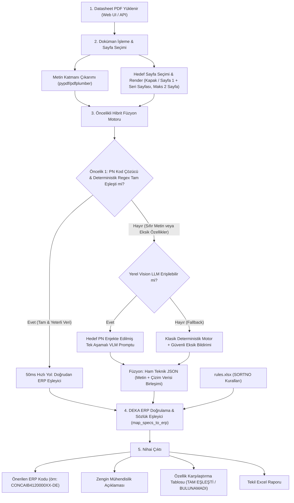

# Vision LLM Destekli Datasheet Analiz ve DEKA ERP Eşleme Sistemi Tasarım Belgesi

**Tarih:** 19 Ekim 2026  
**Durum:** Taslak (İncelemede)  
**Hedef Ortam:** Şirket İçi Portal (Intranet / %100 Offline)  

---

## 1. Amaç ve Vizyon (Intent & Why)

Elektronik bileşen datasheet analizi sürecinde sadece statik Regex ve metin tabanlı kurallara dayanan sistemler iki temel tıkanma yaşamaktadır:
1. **Vektörel CAD Çizimleri (Sıfır Metin):** Konnektör (CON), klemens, pil yuvası (BAH) gibi mekanik ağırlıklı ürünlerde PDF'ler AutoCAD/SolidWorks ortamından çizgi/eğri (vector spline) olarak basılmakta ve dijital metin katmanı sıfır karakter (`len(text) == 0`) olmaktadır.
2. **Kural Şişmesi ("Köstebek Vurmaca"):** Her yeni üretici veya şablon için tek tek regex yazmak, yüz binlerce üreticinin bulunduğu sektörde sürdürülemez bir bakım yükü ve kural çakışmaları yaratmaktadır.

Bu tasarım belgesi; şirket portalında **%100 yerel (offline)**, gizlilik ihlali olmadan, CPU tabanlı sunucularda akıcı çalışan **Görsel Dil Modeli (Vision LLM / VLM)** destekli hibrit bir datasheet analiz mimarisini tanımlar.

---

## 2. Hedefler, Kapsam Dışı Konular ve Anti-Hedefler

### Hedefler (Goals)
- **Evrensel Format Desteği:** Hem standart dijital metinli PDF'leri hem de sıfır metinli vektörel CAD çizimlerini (Degson, KLS, vb.) hatasız okumak.
- **Tekil Yükleme Akışı:** Kullanıcının portal üzerinden tek bir datasheet yükleyip 3-6 saniye içinde zengin ve doğrulanmış ERP sonucunu ekranda görmesi.
- **Çok Modlu Bilgi Füzyonu (Multimodal Fusion):** Bilginin nerede olduğunu (metin, tablo, ölçülendirme oku veya başlık kutusu) tahmin etmek zorunda kalmadan, sayfanın görüntüsünden ve varsa metninden özellikleri tek seferde çıkarmak.
- **%100 Deterministik ERP Kodlaması:** Çıkarılan ham teknik verileri DEKA ERP kural kitabındaki (`rules.xlsx`) SORTNO, Prefix ve VALUE kurallarıyla birleştirip hatasız ERP kodu üretmek.
- **Offline & CPU Uyumlu:** Dış bulut servislerine (OpenAI, Anthropic vb.) sıfır bağımlılık; şirket intranetinde CPU üzerinde düşük bellek tüketimiyle (4-bit quantized VLM) çalışmak.

### Kapsam Dışı Konular (Non-Goals)
- On binlerce sayfalık genel parça kataloglarının tek bir işlemde baştan sona çizim çizim taranması (bu dokümanlar için katalog tespiti ve tam parça numarası isteme mekanizması korunacaktır).
- DEKA ERP kurallarını LLM'e ürettirmek (kural üretimi veya tahmini yapılmaz; kurallar yalnızca `rules.xlsx` kaynağından deterministik olarak işletilir).

### Anti-Hedefler (Ne Yapılmamalı?)
- **ERP Kodu Halüsinasyonu:** LLM'e asla "Bana DEKA ERP kodu üret" denilmeyecektir! LLM sadece ham teknik özellikleri (Pitch, Pin, Voltaj, Kılıf vb.) okuyacak; ERP kodunu DEKA sözlük motorumuz üretecektir.
- **CPU Kilitlenmesi:** Ağır 11B/70B modeller yerine CPU optimize 2B-3B modeller (`Qwen2-VL-2B` veya `Llama-3.2-3B-Vision`) tercih edilecek; sunucunun diğer portal işlevlerini kilitlemesi engellenecektir.
- **Katı Hata Çöküşü (Hard Failure):** Eğer yerel Vision LLM servisi (Ollama) o anda yanıt vermezse, sistem çökmeyecek; otomatik olarak deterministik fallback motorunu devreye sokacaktır.

---

## 3. Sistem Mimarisi ve Veri Akışı



---

## 4. Akıllı Sayfa Seçimi ve Hedef Parça Numarası Enjeksiyonu

### 4.1 Akıllı Sayfa Seçimi (Sayfa Sayısını Sınırlandırma)
CPU üzerinde çıkarım süresini 3-6 saniye bandında tutmak için PDF'in tüm sayfaları değil, en kritik en fazla 2 sayfası seçilir:
1. **Sayfa 1 (Kapak / Genel Çizim):** Çoğu CAD çizimi ve terminal block dokümanı tek veya iki sayfadır; ana mekanik ölçüler kapakta yer alır.
2. **Seri / Parça Kodunu İçeren Sayfa:** Kullanıcının girdiği parça numarası (`target_pn`) veya tespit edilen seri kodu (örn: `12P`, `DG8HS`, `12-15HS`) hangi sayfada geçiyorsa o sayfa seçilir.
3. Toplam görsel girdi **maksimum 2 sayfa** ile sınırlandırılır.

### 4.2 Hedef Parça Numarası (Target PN) Enjeksiyonu
Mühendislik çizimlerinde aynı çizim üzerinde bir tablonun satırlarında 2 pinden 24 pine kadar tüm varyantlar yer alabilir (örneğin Degson çiziminde 2P'den 24P'ye kadar tablo vardır).
VLM promptuna **kullanıcının hedef parça kodu** açıkça enjekte edilir:
> `Target Part Number: DG8HS-1.2-12P-17-100SH/AH`
> `Notice: This drawing may contain dimensions for multiple pin counts (2P-24P). Look up the exact row/column corresponding to the Target Part Number (e.g. 12P / 12 pins) and extract dimensions for that variant.`

---

## 5. Ürün Türlerine Göre Ayrıştırma ve Karar Mekanizması

Her ürün türü (`CON`, `RES`, `CAP`, `BUZ`, `VAR`, `DIO`, `BAH`, `FET`, `TRA`, `ICR`, `REL`, `ANT`) DEKA ERP sözlüğünde tamamen farklı kurallara ve SORTNO alanlarına sahiptir. Sistem şu aşamalı karar mekanizmasını işletir:

### Adım 1: Öncelik Sıralaması (Priority Cascade)
1. **PN Decoder (En Yüksek Öncelik):** Bilinen üretici parça kodlama formatları (örn: `DG8HS-1.2-12P` -> Degson, 1.2 pitch, 12 pin, Cable to Wire klemens; `RC0805FR-0710KL` -> Yageo 0805 10k 1%).
2. **Deterministik Metin Regex (50ms Hızlı Yol):** Eğer PDF içinde net metin varsa ve tüm zorunlu ERP alanları metinden tam doğrulukla çıkabiliyorsa, VLM'e gerek kalmadan anında sonuç üretilir.
3. **Vision LLM Füzyonu:** Eğer PDF sıfır metinli bir CAD çizimiyse veya metinden bazı kritik alanlar (pitch, pin sayısı, açı) eksik/null kaldıysa, VLM devreye girerek görselden bu eksikleri tamamlar.

### Adım 2: Tek Aşamalı Birleşik Şema (Single-Stage Prompt)
Zaman kaybettiren iki aşamalı sorgu (önce türü sor, sonra özellikleri sor) yerine; kullanıcının seçimi yoksa hem tür sınıflandırmasını hem de teknik özellikleri tek bir JSON şemasında dönen birleşik prompt kullanılır:

| Malzeme Türü | Vision LLM'den İstenen Spesifik Alanlar | DEKA ERP Karşılığı (`rules.xlsx`) |
|---|---|---|
| **CON** (Konnektör / Klemens) | `type_connector`, `pin_type`, `pitch`, `pin_number`, `angle`, `mounting`, `manufacturer` | SORTNO 0: Mounting, 5: Type Connector, 7: Pin Type, 10: Pitch, 20: Pin Number, 25: Angle, 40: Q |
| **RES** (Direnç) | `resistance_str`, `tolerance`, `wattage`, `package`, `composition`, `special_def`, `mounting`, `manufacturer` | SORTNO 0: Mounting, 10: Package, 20: Value, 30: Tolerance, 40: Wattage, 60: Composition, 70: Special, 90: Q |
| **CAP** (Kapasitör) | `capacitance_str`, `voltage`, `tolerance`, `package`, `special_def` (dielektrik), `mounting`, `manufacturer` | SORTNO 0: Mounting, 10: Package, 20: Value, 30: Voltage, 40: Tolerance, 50: Dielectric, 80: Q |
| **BUZ** (Buzzer) | `buzzer_voltage`, `buzzer_frequency`, `sound_level`, `buzzer_size`, `mounting`, `manufacturer` | SORTNO 0: Mounting, 10: Voltage, 20: Frequency, 30: Sound Level, 40: Size, 50: Q |
| **VAR** (Varistör) | `varistor_size`, `voltage_ac`, `mounting`, `manufacturer` | SORTNO 0: Mounting, 10: Size, 20: Voltage AC, 50: Q |
| **DIO** (Diyot) | `type_diode`, `voltage`, `current`, `package`, `value_diode`, `mounting`, `manufacturer` | SORTNO 0: Mounting, 10: Package, 20: Value, 30: Voltage, 40: Current, 50: Type Diode, 90: Q |
| **BAH** (Pil Yuvası / Klipsi) | `type_battery_holder`, `mounting`, `manufacturer` | SORTNO 0: Mounting, 10: Type Battery Holder, 40: Q |
| **ANT** (Anten) | `type_antenna`, `cable_length`, `mating_connector`, `protocol`, `mounting`, `manufacturer` | SORTNO 0: Mounting, 10: Type Antenna, 20: Cable Length, 30: Connector, 40: Q |

---

## 6. Yerel Vision LLM Kurulum ve Çalışma Detayı

### Model Seçimi
- **Varsayılan Öneri:** `Qwen2-VL-2B-Instruct` veya `Llama-3.2-3B-Vision-Instruct` (GGUF / Ollama 4-bit formatı).
- **Bellek (RAM) İhtiyacı:** ~2.5 GB - 3.5 GB RAM.
- **CPU Çıkarım Süresi:** Sayfa başına ortalama 3 - 6 saniye.
- **Bağlantı Protokolü:** Yerel HTTP REST API (`http://localhost:11434/api/chat`).

### İstek Formatı (Örnek Prompt Kurgusu)
```json
{
  "model": "llama3.2-vision:3b",
  "messages": [
    {
      "role": "user",
      "content": "You are an expert electronics engineer analyzing an engineering component drawing/datasheet. Extract technical specifications strictly adhering to the JSON schema below. Do not guess or hallucinate. If an attribute is not visible, return null.\n\nTarget Part Number: DG8HS-1.2-12P-17-100SH/AH\nNotice: If the drawing lists a table of variants (e.g. 2P to 24P), focus on the row/dimensions matching the Target Part Number (12 pins).\n\nOutput JSON Schema:\n{\n  \"material_type\": \"CON\" | \"RES\" | \"CAP\" | \"BUZ\" | \"VAR\" | \"DIO\" | \"BAH\" | \"ANT\",\n  \"confidence\": 0.0 - 1.0,\n  \"manufacturer\": string | null,\n  \"specs\": {\n    \"type_connector\": string | null,\n    \"pitch\": string | null,\n    \"pin_number\": string | null,\n    \"pin_type\": \"Erkek\" | \"Dişi\" | null,\n    \"mounting\": \"TH\" | \"SMD\" | \"Cable\" | null,\n    \"angle\": \"90°(Yatık)\" | \"180°(Dik)\" | null,\n    \"package\": string | null,\n    \"value\": string | null,\n    \"voltage\": string | null,\n    \"tolerance\": string | null\n  }\n}",
      "images": ["<base64_encoded_page_image_1>", "<base64_encoded_page_image_2>"]
    }
  ],
  "format": "json",
  "stream": false
}
```

---

## 7. Güvenlik, Fallback ve Dayanıklılık (Resilience)

1. **Ollama / Model Çökme Koruması:** Eğer Ollama servisi çalışmıyorsa veya zaman aşımına (timeout) uğrarsa, sistem hata fırlatıp kullanıcıya 500 dönmez; otomatik olarak mevcut deterministik kural motoru (`extract_component_specs`) ile devam eder.
2. **Kör Fallback Engellemesi:** Eğer doküman metinsizse ve model erişilemezse, bilinmeyen parçalar artık otomatik olarak `CAP` (Kapasitör) yapılmaz; `BİLİNMİYOR` olarak işaretlenir ve kullanıcıdan parça kodu doğrulaması istenir.
3. **DEKA ERP Kural Kilidi:** Vision LLM sadece ham değerleri okur (`8.2mm`, `12 pin`). Bu değerlerin `rules.xlsx` içindeki `4` ve `12` kodlarına dönüştürülmesi DEKA deterministik motoru tarafından yapılır. Modelin kafasına göre ERP kodu üretmesi imkansızdır.

---

## 8. Uygulayıcıya (Builder) Bırakılan Detaylar

- Ollama REST istemcisinin `src/bom_enricher/vision_client.py` modülü olarak temiz bir servis sınıfı halinde yazılması.
- Sayfa resimleme işlemi için `pymupdf` (fitz) veya `pdf2image` kullanarak yüksek kaliteli (150 DPI) PNG üretimi.
- Web arayüzünde tekil analiz ekranına "Vision AI Destekli" rozeti ve analiz aşamalarını gösteren durum bildiriminin eklenmesi.
