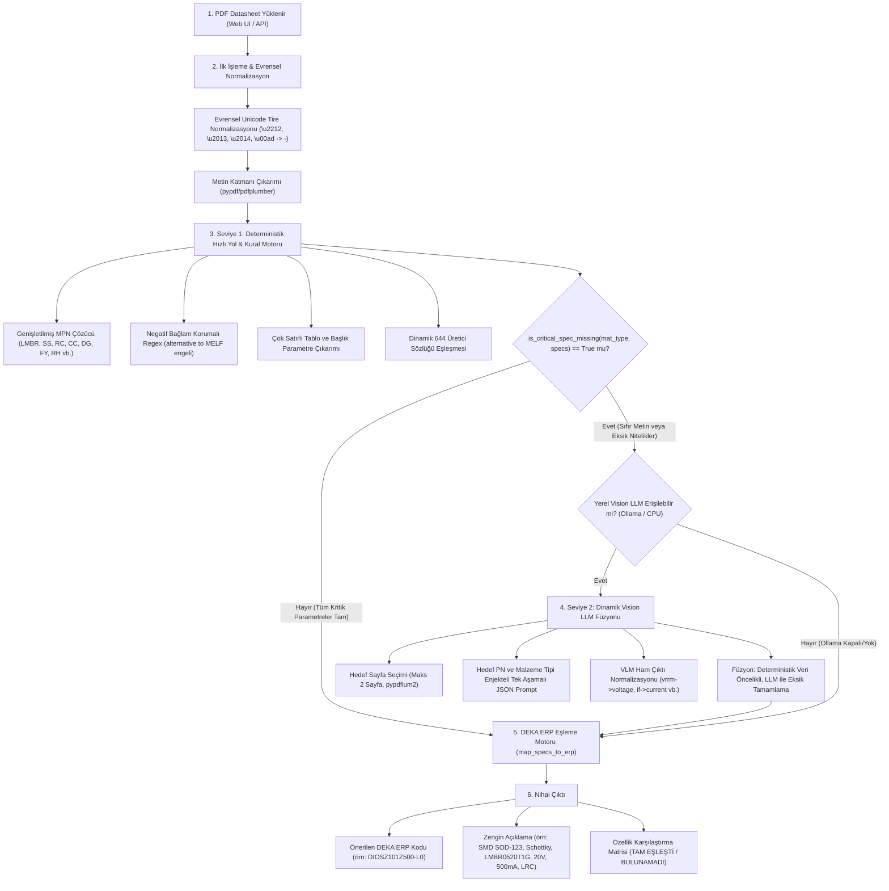

# Evrensel Hibrit Datasheet Analiz ve DEKA ERP Eşleme Sistemi Tasarım Belgesi

**Tarih:** 20 Ekim 2026  
**Durum:** Onaylandı (Builder İncelemesi Tamamlandı)  
**Hedef Ortam:** Şirket İçi Portal (Intranet / %100 Offline / CPU Tabanlı Sunucu)  
**Tasarım Sahibi:** AI Assistant (Antigravity) & Kullanıcı  

---

## 1. Amaç ve Kapsam (Intent & Why)

DEKA ERP kodlama sisteminde yüz binlerce farklı elektronik bileşen, 30'dan fazla malzeme grubu (`DIO`, `RES`, `CAP`, `CON`, `IND`, `CRY`, `DSP`, `TRA`, `IC`, `REL`, `SWI`, `FUS`, `BAH` vb.) ve `rules.xlsx` dosyasında tanımlı 640'tan fazla üretici ile binlerce kural satırı bulunmaktadır.

Kullanıcıların portala yüklediği datasheet'ler iki temel uç nokta arasında değişmektedir:
1. **Dijital Metin İçeren Datasheet'ler:** Ancak üreticiye özgü yazım varyasyonları (örn. Unicode eksi işareti `\u2212`, dağınık çok satırlı tablolar, *"alternative to MELF"* gibi yanıltıcı negatif ifadeler) statik regex kurallarını yanıltabilmektedir.
2. **Vektörel CAD Çizimleri ve Taranmış Görseller:** Sıfır metin katmanı (`len(text) == 0`) veya metin katmanında elektriksel/fiziksel parametrelerin bulunmadığı saf çizim dokümanları.

Bu tasarımla; **sistemdeki tüm 30+ malzeme türünü dinamik olarak kapsayan, CPU üzerinde %100 offline çalışan, regex zafiyetlerinden arındırılmış, MPN marka önceliğini gözeten ve deterministik DEKA ERP kurallarıyla kusursuz eşleşen Evrensel Hibrit Mimari** kurulacaktır.

---

## 2. Hedefler, Kapsam Dışı Konular ve Anti-Hedefler

### Hedefler (Goals)
1. **Evrensel Malzeme Türü Kapsamı:** `rules.xlsx` içerisindeki tüm malzeme kategorilerinde (`DIO`, `CRY`, `DSP`, `TRA`, `IC`, `REL`, `SWI`, `FUS`, `BAH`, vb.) kritik eksiklikleri dinamik olarak tespit edebilme (`is_critical_spec_missing`) ve gerektiğinde Vision LLM'i otomatik devreye sokma.
2. **Unicode ve Negatif Bağlam Direnci:** PDF metnindeki tüm Unicode tire varyasyonlarını (`\u2212`, `\u2010`, `\u2011`, `\u2012`, `\u2013`, `\u2014`, `\u00ad`) standart `-` karakterine normalizasyon; *"alternative to"*, *"replaces"*, *"not recommended for"* gibi negatif ifadeleri kılıf/paket eşleşmelerinden eleme.
3. **Endüstri Standardı Parça Kodu (MPN) Çözücü Genişletmesi & Marka Otoritesi:** `(L)MBR` Schottky diyot serisi gibi yüksek hacimli serilerin parça numarasından üretici (`LMBR` -> `LRC` / `L0`), akım (`05` -> `500mA`), gerilim (`20` -> `20V`) ve kılıf (`SOD-123` -> `Z10`) bilgilerini anında çözme. Hedef parça numarasında açıkça üretici markası/ön eki varsa (`LMBR` -> LRC), PDF altbilgisindeki genel telif yazılarına ("On Semi") ezdirilmeyip hedef üretici korunacaktır.
4. **Çok Satırlı Tablo ve Başlık Ayrıştırma:** Kapak sayfasındaki büyük puntolu başlık kalıplarını (`0.5 AMPERES, 20 VOLTS`) ve aralıklı `VRRM`/`IF(AV)` tablolarını yakalama.
5. **CPU Uyumlu ve %100 Offline Çalışma:** Şirket intranetinde dış buluta veri göndermeden, yerel CPU sunucusunda düşük bellek tüketimi (en fazla 2 sayfa render, hafif 3B model) ile çalışma.
6. **Sıfır Halüsinasyonlu Deterministik ERP Kodlaması:** LLM sadece ham teknik özellikleri okur; nihai ERP kodu (`DIOSZ101Z500-L0`) her zaman `rules.xlsx` sözlük motoru (`map_specs_to_erp`) tarafından %100 deterministik olarak üretilir.

### Kapsam Dışı Konular (Non-Goals)
- Binlerce sayfalık genel ürün kataloglarının (Master Catalog) sayfa sayfa taranması (katalog koruma ve hedef parça numarası zorunluluğu sürdürülecektir).
- Dış bulut LLM servislerine (OpenAI, Gemini API vb.) bağımlılık kurmak (şirket içi CPU üzerinde %100 yerel kalınacaktır).

### Anti-Hedefler (Ne Yapılmamalı?)
- **LLM'e ERP Kodu Ürettirmemek:** LLM asla ERP kodu tahmin etmeyecektir.
- **Her PDF'i CPU LLM'e Sokup Yavaşlatmamak:** Zaten Seviye 1'de tam çözülen standart direnç/kapasitör/diyotlar için CPU Vision LLM gereksiz yere çalıştırılmayacak; <100ms hızı korunacaktır.
- **Sessiz Çöküş:** Yerel Ollama servisi kapalıysa sistem asla hata vermeyecek; Seviye 1 kural motorunun sonuçlarını güvenle kullanıcıya sunacaktır.

---

## 3. Sistem Mimarisi ve Çok Seviyeli Akış



---

## 4. Detaylı Teknik Kararlar ve Tasarım

### 4.1. Evrensel Unicode Normalizasyonu
`extract_pdf_data` fonksiyonunun başlangıcında, ayıklanan tüm metin anında normalize edilir:
```python
UNICODE_DASH_PATTERN = re.compile(r"[\u2212\u2010\u2011\u2012\u2013\u2014\u00ad]")
clean_text = UNICODE_DASH_PATTERN.sub("-", raw_text)
```
Bu sayede `SOD−123` metni sistemin en başında `SOD-123` haline gelir ve regex motorunun ıskalama ihtimali ortadan kalkar.

### 4.2. Negatif Bağlam Koruması (Negative Context Guard)
Paket regex'inde karşılaştırma veya uyumluluk cümlelerinde geçen paket isimlerinin elenmesi:
```python
NEGATIVE_PKG_CONTEXT = re.compile(
    r"\b(?:alternative\s+to(?:\s+the)?|replaces?|instead\s+of|versus|vs\.?)\s+(?:[a-z0-9-]+\s+){0,3}(melf|sod-?\d+|sot-?\d+)\b",
    re.IGNORECASE
)
```

### 4.3. Dinamik Kritik Nitelik Değerlendiricisi (`is_critical_spec_missing`)
Statik `if mat_type == "CON"` yerine merkezi, yapılandırılabilir ve güvenli bir değerlendirme fonksiyonu:
```python
CRITICAL_SPECS_BY_MATERIAL_TYPE: dict[str, tuple[str, ...]] = {
    "CON": ("pitch", "pin_number", "type_connector"),
    "RES": ("resistance_str",),
    "CAP": ("capacitance_str", "capacitance_pf"),
    "IND": ("inductance_str",),
    "DIO": ("voltage", "current"),
    "TRA": ("vds", "vce", "type_transistor"),
    "CRY": ("frequency_str",),
    "DSP": ("type_display", "color"),
    "FUS": ("current", "voltage"),
    "REL": ("coil_voltage", "contact_current"),
    "SWI": ("type_switch",),
}

def is_critical_spec_missing(mat_type: str, specs: dict[str, Any], text_empty: bool) -> bool:
    if text_empty or mat_type == "BİLİNMİYOR" or not mat_type:
        return True
    req = CRITICAL_SPECS_BY_MATERIAL_TYPE.get(mat_type)
    if req:
        # En az bir temel parametre mutlaka bulunmalı
        return not any(specs.get(k) for k in req)
    # Listelenmemiş diğer 20+ malzeme tipi için genel güvenlik kontrolü:
    # Kılıf ve en az bir teknik nitelik çıkarılamadıysa eksik say
    return not specs.get("package") and len(specs) <= 2
```
Bu sayede:
1. Temel parametreleri tamam olan standart direnç/kapasitör/diyotlar asla gereksiz yere ağır CPU LLM'e sokulmaz (throughput korunur).
2. Taranmış görsel veya CAD olan tüm malzeme tipleri otomatik olarak Vision LLM'e yönlendirilir.

### 4.4. MPN Çözücü Genişletmesi & Üretici Marka Otoritesi
`decode_manufacturer_pn` içine `(L)MBR` Schottky desteği eklenir:
* Kalıp: `r"^(L)?MBR(05|[1-9])(\d{2})(?:[A-Z0-9]+)?$"`
* Ön ek `LMBR`: `manufacturer = "LRC"`, `manufacturer_code = "L0"`
* Ön ek `MBR`: `manufacturer = "On Semi"`, `manufacturer_code = "ON"`
* Akım: `05` -> `500mA`, `1` -> `1A`, `2` -> `2A` vb.
* Voltaj: `20` -> `20V`, `40` -> `40V` vb.
* Kılıf: `SOD-123` (MBR05xx serisi için standart).
* Montaj: `SMD`, Diyot Tipi: `Schottky`.

**Üretici Öncelik Kuralı:**
Hedef parça numarasında açıkça üretici markası/ön eki tanımlanmışsa (örn. `LMBR` -> `LRC`), PDF altbilgisindeki genel telif yazıları (`On Semi`) hedef üreticinin üzerine yazamaz!
```python
# Eğer PN çözücüsü kesin bir üretici kodu ürettiyse (pn_specs['manufacturer_code']), bu değer doküman metninden üstündür:
if pn_specs.get("manufacturer_code"):
    specs["manufacturer"] = pn_specs["manufacturer"]
    specs["manufacturer_code"] = pn_specs["manufacturer_code"]
```

### 4.5. Çok Satırlı Tablo ve Başlık Ayrıştırma
`extract_component_specs` altında diyot parametreleri için:
* Başlık kalıbı: `r"(\d+(?:\.\d+)?)\s*(?:amperes?|amps?|a)\s*,\s*(\d+)\s*(?:volts?|v)\b"`
* Tablo toleranslı voltaj aralığı: `r"(?:v_?rrm|v_?rwm|v_?dc|blocking\s+voltage)[\s\S]{1,40}?(\d+)\s*v\b"`
* Tablo toleranslı akım aralığı: `r"(?:average\s+rectified\s+forward\s+current|if\(av\))[\s\S]{1,60}?(\d+(?:\.\d+)?)\s*a\b"`

### 4.6. Vision LLM Çıktı Normalizasyonu & Test Stratejisi
* LLM modellerinin üretebileceği farklı alan adları (`vrrm`, `forward_voltage`, `breakdown_voltage` -> `voltage`; `if`, `rated_current` -> `current`) `vision_client.py` çıkışında dahili anahtar sözlüğümüze (`specs` formatı) normalize edilir.
* Seviye 2 Vision LLM hattının doğrulanması için; metinsiz CAD çizim testlerine ek olarak sıfır metinli taranmış diyot/kristal sentetik test senaryosu eklenir.

---

## 5. Doğrulama ve Test Kriterleri

1. **Hedef Örnek Doğrulaması (`LMBR0520T1G`):**
   - Parça No: `LMBR0520T1G`
   - Giriş PDF: `media_1792498512919_57ed33a0.pdf`
   - Çıktı ERP Kodu: **`DIOSZ101Z500-L0`** (Birebir eşleşmeli).
   - Zengin Açıklama: **`SMD SOD-123, Schottky, LMBR0520T1G, 20V, 500mA, LRC`** (Çift virgül veya eksiklik olmadan).
2. **Evrensel Kritik Eksiklik ve Multimodal Füzyon Doğrulaması:**
   - Sıfır metinli diyot veya klemens çiziminde `is_critical_spec_missing`'in `True` dönüp Vision LLM'i tetiklemesi.
   - VLM'den dönen `vrrm`/`if` alanlarının `voltage`/`current` olarak normalize edilerek ERP kodunu eksiksiz üretmesi.
3. **Kapsamlı Regresyon Testi:**
   - Mevcut tüm 156 birim ve entegrasyon testinin sıfır hata ile geçmesi.
4. **Performans Kriteri:**
   - Seviye 1 kural motoru < 100ms.
   - Vision LLM CPU üzerinde < 6 saniye.
