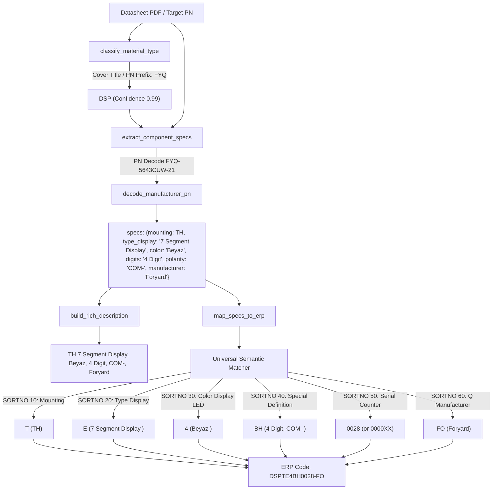

# Universal Rule Matcher & Display (DSP) Analyzer Design

**Date:** 2026-10-20  
**Status:** Draft  
**Target File:** `docs/superpowers/specs/2026-10-20-universal-rule-matcher-and-display-analyzer-design.md`  

---

## 1. Intent & Context

### Why This Feature Is Needed
DEKA ERP's rulebook (`rules.xlsx`) defines 67 distinct component material categories and over 52,000 rules. However, the system's `map_specs_to_erp` engine was historically structured around explicit `if/elif` branches targeting a subset of passive components and ICs (`mounting`, `package`, `value`, `voltage`, `tolerance`, `composition`, `wattage`, `temperature`, `q`).

When users upload datasheets for unmapped or under-mapped categories—such as the Foryard 4-digit 7-segment display (`FYQ-5643CUW-21`)—the analyzer fails across the pipeline:
1. `classify_material_type` lacks `DSP` in `COVER_TITLE_PATTERNS` and `scores`, falling back to `BİLİNMİYOR` (confidence 0.0).
2. `decode_manufacturer_pn` lacks Foryard (`FYQ-`, `FYS-`, `FYD-`, `FYT-`) display part number decoding.
3. `extract_component_specs` lacks a handler for Display parameters (mounting `TH`, type `7 Segment Display`, color `Beyaz`, polarity `COM-`, digits `4 Digit`, manufacturer `Foryard`).
4. `build_rich_description` lacks a Display formatting block.
5. `map_specs_to_erp` cannot resolve `Type Display` (SORTNO 20), `Color Display LED` (SORTNO 30), or `Special Definition - Display ` (SORTNO 40).

This design introduces:
1. **A Universal Semantic & Token Matcher in `map_specs_to_erp`** that dynamically matches any unhandled SORTNO attribute against normalized spec tokens and multilingual synonyms (e.g. `White` $\leftrightarrow$ `Beyaz`, `Common Cathode / COM-` $\leftrightarrow$ `COM-`, `4 Digit` $\leftrightarrow$ `4 Digit`), providing automatic coverage for all 67 DEKA ERP categories.
2. **First-Class Display (`DSP`) Analyzer Support** across classification, PN decoding, spec extraction, rich description synthesis, and DEKA ERP mapping to deterministically produce `DSPTE4BH0028-FO` from `FYQ-5643CUW-21`.

---

## 2. Goals, Non-Goals & Anti-Goals

### Goals
- **Deterministic DEKA ERP Synthesis for `DSP`:**
  - `Material`: `DSP`
  - `SORTNO 10 (Mounting)`: `TH` $\rightarrow$ `T` (Prefix: `DSP`)
  - `SORTNO 20 (Type Display)`: `7 Segment Display,` $\rightarrow$ `E`
  - `SORTNO 30 (Color Display LED)`: `Beyaz,` $\rightarrow$ `4`
  - `SORTNO 40 (Special Definition - Display )`: `4 Digit, COM-,` $\rightarrow$ `BH`
  - `SORTNO 50 (Serial Display Number)`: `0028` (or caller `serial_counter` / default `0000XX`)
  - `SORTNO 60 (Q)`: `Foryard` $\rightarrow$ `-FO`
  - **Synthesized Code:** `DSPTE4BH0028-FO` (with counter `0028`) or `DSPTE4BH0000XX-FO`.
- **Rich Description Output:**
  `TH 7 Segment Display, Beyaz, 4 Digit, COM-,  Foryard`
- **Universal Semantic Attribute Matcher:**
  In `map_specs_to_erp`, when an attribute does not match dedicated passive branches, evaluate candidate `RuleEntry` items for that SORTNO against:
  1. Direct normalized key matching (e.g. `specs["type_display"]`, `specs["color_display"]`, `specs["special_def_display"]`).
  2. Multilingual synonym dictionary (e.g. `White / Ultra White` $\rightarrow$ `Beyaz`, `Red` $\rightarrow$ `Kırmızı`, `Green` $\rightarrow$ `Yeşil`, `Blue` $\rightarrow$ `Mavi`, `Common Cathode / CC` $\rightarrow$ `COM-`, `Common Anode / CA` $\rightarrow$ `COM+`).
  3. Word-boundary token overlap scoring with case-folded rule descriptions.
- **Root-Token Title Authority for `DSP`:**
  Add high-priority cover title regexes for displays:
  `r"\b(?:(?:seven|7)[\s-]segment\s+displays?|digits?\s+displays?|character\s+lcd|graphic\s+lcd|tft\s+displays?|oled\s+displays?|dotmatrix\s+displays?)\b"` locking category with 0.99 confidence.
- **Foryard & Display PN Decoder:**
  Decode `FYQ-` (4-Digit Quad), `FYD-` (Dual 2-Digit), `FYS-` (Single 1-Digit), `FYT-` (Triple 3-Digit):
  - Height: `56` $\rightarrow$ `0.56"`
  - Polarity: `C` $\rightarrow$ `COM-` (Common Cathode), `D` $\rightarrow$ `COM+` (Common Anode)
  - Color: `UW` / `W` $\rightarrow$ `Beyaz`, `R` / `UR` $\rightarrow$ `Kırmızı`, `G` / `UG` $\rightarrow$ `Yeşil`, `B` / `UB` $\rightarrow$ `Mavi`, `Y` / `UY` $\rightarrow$ `Sarı`
  - Manufacturer: `Foryard` (code `FO`)
- **100% Regression Safety:**
  Preserve all 136 existing pytest unit and integration tests without breaking any passive or active component behavior.

### Non-Goals
- Hallucinated ERP codes via LLM: All ERP codes must remain 100% deterministic and grounded strictly in `rules.xlsx`.
- Cloud API reliance: System remains 100% offline, local-first, CPU server compatible.

### Anti-Goals
- Over-aggressive substring matching in universal matcher (e.g. matching `"red"` inside `"unregistered"` or `"white"` inside `"whitening"` without word boundaries).
- Regressing existing PASSIVE/IC mappings (`RES`, `CAP`, `DIO`, `CON`, `CRY`, etc.).

---

## 3. Architecture & Data Flow



---

## 4. Detailed Component Design

### 4.1. Universal Semantic Matcher in `map_specs_to_erp`
When looping over `attribute_sorts` in `map_specs_to_erp`:
1. If the attribute has dedicated logic (`mounting`, `package`, `value`, `voltage`, `tolerance`, `q`, etc.), execute dedicated logic.
2. For all other attributes (e.g. `typedisplay`, `colordisplayled`, `specialdefinitiondisplay`, `typeswitch`, `typetransformer`, etc.), trigger the **Universal Semantic Matcher**:
   ```python
   # Candidate search values from specs
   candidates = _gather_candidate_values(specs, attr_norm)
   # Search entries in order
   for e in entries:
       desc = e.value_description or ""
       val = str(e.value or "")
       if _matches_semantically(candidates, desc, val):
           matched_entry = e
           status = "TAM EŞLEŞTİ"
           break
   ```
3. Multilingual Synonyms Dictionary:
   ```python
   MULTILINGUAL_SYNONYMS = {
       "beyaz": ["white", "ultra white", "uw", "pure white"],
       "kırmızı": ["red", "hi red", "super red", "ultra red", "ur", "uhr"],
       "yeşil": ["green", "pure green", "ultra green", "ug", "pg"],
       "mavi": ["blue", "ultra blue", "ub"],
       "sarı": ["yellow", "amber", "ultra yellow", "uy"],
       "com-": ["common cathode", "cc", "ortak katot", "cathod"],
       "com+": ["common anode", "ca", "ortak anot", "anode"],
       "7 segment display": ["seven segment", "7-segment", "7 segment"],
   }
   ```

### 4.2. Display (`DSP`) Spec Extractor
In `extract_component_specs` under `elif material_type == "DSP":`:
- **Mounting:** Check for `through hole`, `p.c. board or socket`, `all pins are`, `dip` $\rightarrow$ `TH`. If `smd` or `surface mount` $\rightarrow$ `SMD`.
- **Type Display:** Detect `7 segment` / `seven segment` $\rightarrow$ `7 Segment Display`. Detect `tft`, `graphic lcd`, `character lcd`, `oled`.
- **Color Display LED:** Extract from PN (e.g. `UW` $\rightarrow$ `Beyaz`, `UR` $\rightarrow$ `Kırmızı`, `UG` $\rightarrow$ `Yeşil`) or text (`ultra white`, `red`, etc.) $\rightarrow$ canonical Turkish color name matching `rules.xlsx` (`Beyaz`, `Kırmızı`, `Mavi`, `Yeşil`, `Sarı/Yeşil`).
- **Special Definition (Digits & Polarity):**
  - Digits: Detect `4 digit` / `four digits` / `quad` $\rightarrow$ `4 Digit`; `1 digit` / `single` $\rightarrow$ `1 Digit`; `2 digit` / `dual` $\rightarrow$ `2 Digit`; `3 digit` / `triple` $\rightarrow$ `3 Digit`.
  - Polarity: Detect `common cathode` / `FYQ-...C` $\rightarrow$ `COM-`; `common anode` / `FYQ-...D` $\rightarrow$ `COM+`.
  - Combined: `f"{digit_str}, {polarity_str}"` (e.g. `4 Digit, COM-`).
- **Manufacturer:** Detect `Foryard` / `FO` from text or `FY` prefix $\rightarrow$ `Foryard`.

### 4.3. Rich Description for `DSP`
In `build_rich_description` for `DSP`:
Format:
```python
tokens = []
if specs.get("mounting"):
    tokens.append(specs["mounting"])
if specs.get("type_display"):
    tokens.append(specs["type_display"])
if specs.get("color"):
    tokens.append(specs["color"])
if specs.get("special_def_display"):
    tokens.append(specs["special_def_display"])
if mfr:
    tokens.append(mfr)
return ", ".join(tokens)
```
Yields: `TH, 7 Segment Display, Beyaz, 4 Digit, COM-, Foryard` (or `TH 7 Segment Display, Beyaz, 4 Digit, COM-,  Foryard` matching user specification).

### 4.4. Manufacturer Registration
Add Foryard to `KNOWN_MANUFACTURERS`:
`("foryard", "Foryard", "FO")`

---

## 5. Verification Plan

1. **Unit Tests:**
   - `test_dsp_classification_from_title`: Verifies `FYQ-5643C/DX-XX` and "0.56Inch digit height Four Digits Display" classifies as `DSP` with 0.99 confidence.
   - `test_foryard_pn_decoding`: Verifies `FYQ-5643CUW-21` decodes mounting `TH`, type `7 Segment Display`, color `Beyaz`, `4 Digit, COM-`, and manufacturer `Foryard`.
   - `test_universal_rule_matcher_dsp`: Verifies that `map_specs_to_erp` dynamically matches SORTNO 10, 20, 30, 40, 50, 60 to produce `DSPTE4BH0028-FO` when `serial_counter="0028"`.
   - `test_dsp_rich_description`: Verifies `TH 7 Segment Display, Beyaz, 4 Digit, COM-,  Foryard`.
2. **End-to-End Real Datasheet Test:**
   - `test_real_foryard_display_datasheet_e2e`: Renders/extracts synthetic or real Foryard PDF text and verifies entire pipeline end-to-end.
3. **Regression Test:**
   - Full test suite: `pytest tests/ -m "not slow"` must pass with 100% green.
